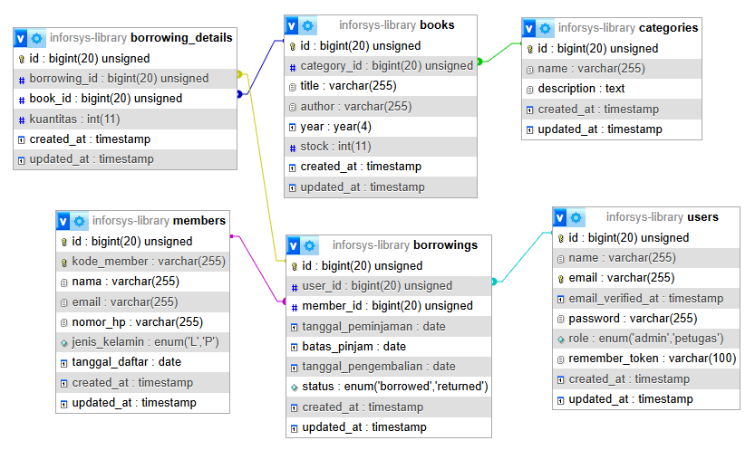
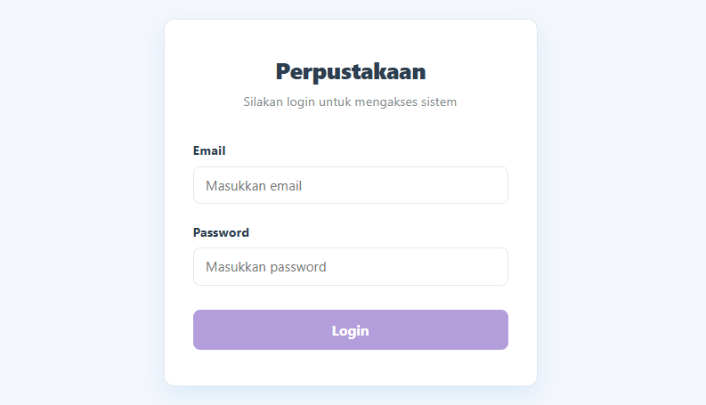
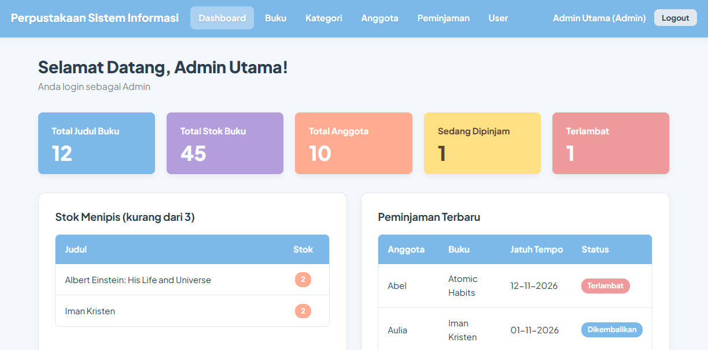
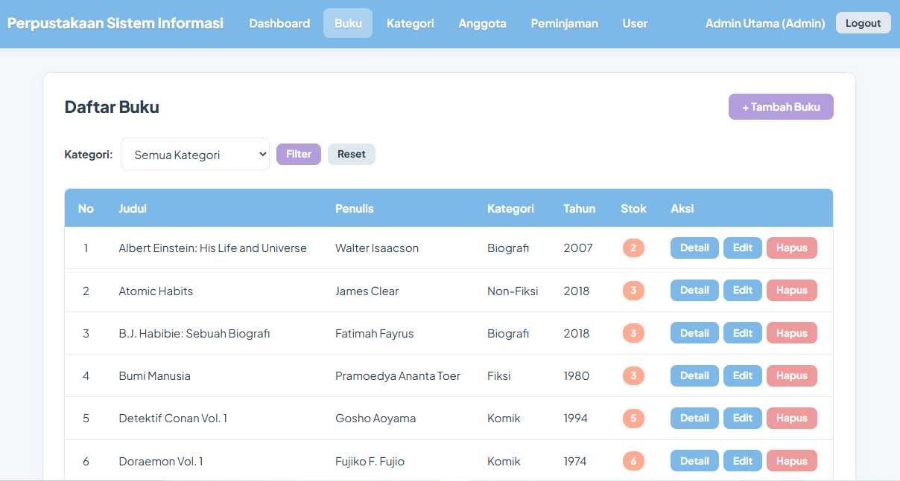
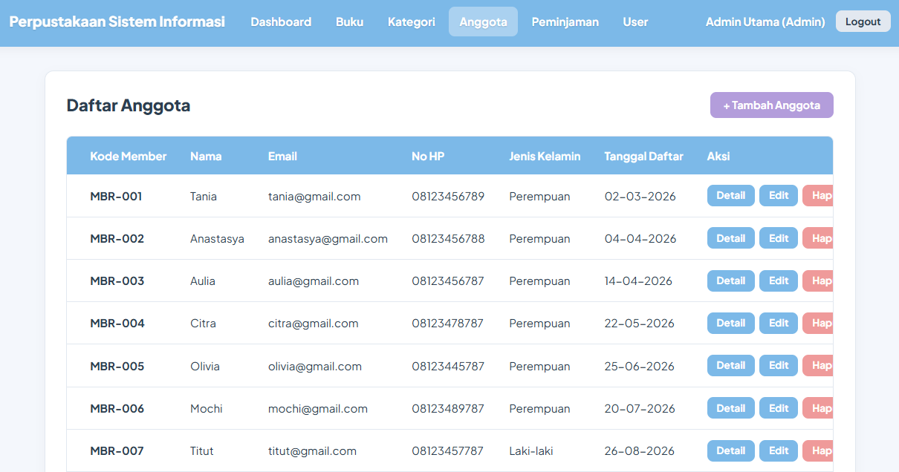
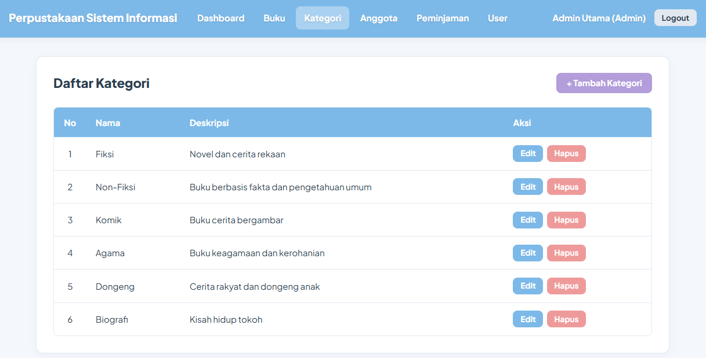

# Sistem Informasi Perpustakaan Sederhana

Proyek UAS mata kuliah **Pemrograman Web Framework**, S1 Sistem Informasi, Universitas Singaperbangsa Karawang.

## Anggota Kelompok 4 (5A)

- **Juliana Tri Aulia** (2410631250094) — Autentikasi, role dan hak akses, dashboard, manajemen user, layout dan CSS global
- **Anastasya Puteri Taruk** (2410631250004) — Kategori dan buku (CRUD, validasi, filter buku per kategori)
- **Tania Dwi Andini** (2410631250076) — Anggota, peminjaman, pengembalian, fitur keterlambatan

## Deskripsi Aplikasi

Aplikasi web untuk mengelola data perpustakaan mulai dari katalog buku, data anggota, hingga pencatatan peminjaman dan pengembalian buku. Aplikasi digunakan oleh dua jenis pengguna, yaitu **Admin** dan **Petugas**, sedangkan anggota perpustakaan hanya dicatat sebagai data transaksi.

## Fitur Utama

- Login dan logout pengguna
- Dashboard ringkasan (total judul buku, total stok, total anggota, buku sedang dipinjam, keterlambatan, stok menipis, dan peminjaman terbaru)
- Pengelolaan kategori buku
- Pengelolaan data buku beserta filter per kategori
- Pengelolaan data anggota beserta riwayat peminjaman
- Pencatatan peminjaman dan pengembalian buku (stok berkurang otomatis saat dipinjam dan bertambah saat dikembalikan)
- Penanda keterlambatan otomatis (jatuh tempo 7 hari setelah tanggal pinjam)
- Pengelolaan data user (khusus Admin)

## Hak Akses Pengguna

Pembatasan akses diterapkan di sisi server menggunakan middleware `role`, Gate `manage-users`, dan `BookPolicy`:

- **Admin:** Mengakses dashboard, melihat & mengelola kategori (tambah, ubah, hapus), mengelola buku, mengelola anggota, memproses peminjaman & pengembalian, serta mengelola user.
- **Petugas:** Mengakses dashboard, melihat daftar kategori, mengelola buku, mengelola anggota, serta memproses peminjaman & pengembalian (tidak dapat mengubah/menghapus kategori maupun mengakses menu user).

## Teknologi yang Digunakan

- PHP 8.3+
- Laravel 13
- MySQL
- Composer 2.x
- HTML, CSS, dan Blade

## Persyaratan Sistem

- PHP 8.3 atau lebih baru (dengan ekstensi `pdo_mysql`, `mbstring`, `openssl`, `tokenizer`, `xml`, `ctype`, `json`)
- Composer
- MySQL / MariaDB (XAMPP atau Laragon)
- Git

## Instalasi dan Konfigurasi

1. Clone repository dan masuk ke folder proyek:
   git clone https://github.com/awlia09/PROJEK-UAS-PWF-KEL-4.git
   cd PROJEK-UAS-PWF-KEL-4

2. Install dependensi dan siapkan file `.env`:
   composer install
   cp .env.example .env
   php artisan key:generate

3. Buat database kosong bernama `inforsys-library` di MySQL, lalu sesuaikan konfigurasi berikut di file `.env`:
   APP_LOCALE=id
   DB_CONNECTION=mysql
   DB_HOST=127.0.0.1
   DB_PORT=3306
   DB_DATABASE=inforsys-library
   DB_USERNAME=root
   DB_PASSWORD=

4. Jalankan migrasi beserta seeder data awal, lalu jalankan server lokal:
   php artisan migrate:fresh --seed
   php artisan serve

5. Buka `http://localhost:8000` di browser.

## Akun Demo

Akun bawaan hasil seeder untuk pengujian di lingkungan lokal:

- **Admin:** `admin@gmail.com` / `password123`
- **Petugas:** `petugas@gmail.com` / `password123`

## Struktur Database & Relasi

- **`users`:** `id`, `name`, `email`, `password`, `role` (`admin` / `petugas`)
- **`categories`:** `id`, `name`, `description`
- **`books`:** `id`, `category_id`, `title`, `author`, `year`, `stock`
- **`members`:** `id`, `kode_member`, `nama`, `email`, `nomor_hp`, `jenis_kelamin` (`L` / `P`), `tanggal_daftar`
- **`borrowings`:** `id`, `user_id`, `member_id`, `tanggal_peminjaman`, `batas_pinjam`, `tanggal_pengembalian`, `status` (`borrowed` / `returned`)
- **`borrowing_details`:** `id`, `borrowing_id`, `book_id`, `kuantitas`

**Relasi Eloquent:**
- `Category` → `Book` (One-to-Many)
- `User` → `Borrowing` (One-to-Many)
- `Member` → `Borrowing` (One-to-Many)
- `Borrowing` → `BorrowingDetail` (One-to-Many)
- `Book` → `BorrowingDetail` (One-to-Many)

### Entity Relationship Diagram (ERD)

## Penerapan MVC

- **Model (`app/Models`):** `Book`, `Category`, `Member`, `Borrowing`, `BorrowingDetail`, `User`
- **View (`resources/views`):** Template Blade dengan layout utama `layouts/app.blade.php`
- **Controller (`app/Http/Controllers`):** Logika proses CRUD dan transaksi peminjaman/pengembalian
- **Route (`routes/web.php`):** Pengaturan endpoint aplikasi dan perlindungan middleware
- **Otorisasi:** `RoleMiddleware`, Gate `manage-users` di `AppServiceProvider`, dan `BookPolicy`

## Aturan Bisnis

- Transaksi peminjaman ditolak jika anggota atau buku belum dipilih.
- Buku dengan stok `0` tidak ditampilkan pada daftar pilihan peminjaman.
- Setiap peminjaman yang berhasil mengurangi stok buku sebanyak 1 eksemplar dengan jatuh tempo 7 hari.
- Pengembalian buku mengubah status transaksi menjadi `returned` dan menambah kembali stok buku.
- Transaksi yang sudah berstatus `returned` tidak dapat diproses ulang.
- Buku atau anggota yang memiliki riwayat peminjaman tidak dapat dihapus.
- Admin tidak dapat menghapus akunnya sendiri.

## Screenshot Aplikasi

### Halaman Login

### Halaman Dashboard

### Halaman Buku

### Halaman Anggota

### Halaman Kategori

### Halaman Peminjaman
