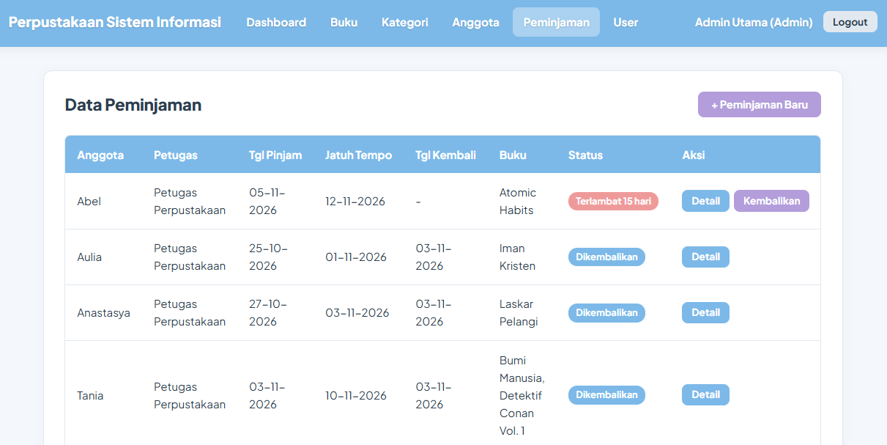

# Sistem Informasi Perpustakaan Sederhana

Proyek UAS mata kuliah **Pemrograman Web Framework (SYS61645)**, S1 Sistem Informasi, Universitas Singaperbangsa Karawang.

## Anggota Kelompok 4 (Kelas 5A)

| Nama | NIM | Fokus pengerjaan |
|---|---|---|
| Juliana Tri Aulia | 2410631250094 | Autentikasi, role dan hak akses, dashboard, manajemen user, layout dan CSS global |
| Anastasya Puteri Taruk | 2410631250004 | Kategori dan buku (CRUD, validasi, filter buku per kategori) |
| Tania Dwi Andini | 2410631250076 | Anggota, peminjaman, pengembalian, fitur keterlambatan |

## Deskripsi Aplikasi

Aplikasi web untuk mengelola data perpustakaan: katalog buku, data anggota, serta pencatatan peminjaman dan pengembalian buku. Aplikasi dipakai oleh dua jenis pengguna, yaitu **Admin** dan **Petugas**. Anggota perpustakaan hanyalah data, bukan pengguna yang login.

## Fitur

- Login dan logout
- Dashboard (total judul buku, total stok, total anggota, sedang dipinjam, terlambat, stok menipis, peminjaman terbaru)
- Pengelolaan kategori
- Pengelolaan buku (termasuk filter buku per kategori)
- Pengelolaan anggota (termasuk riwayat peminjaman per anggota)
- Peminjaman dan pengembalian buku (stok berkurang saat dipinjam dan bertambah saat dikembalikan)
- Penanda keterlambatan (jatuh tempo 7 hari setelah tanggal pinjam)
- Pengelolaan user (khusus Admin)
- Hak akses berdasarkan role (Admin dan Petugas)

## Hak Akses

| Fitur | Admin | Petugas |
|---|:---:|:---:|
| Dashboard | ✔ | ✔ |
| Lihat kategori | ✔ | ✔ |
| Tambah, ubah, hapus kategori | ✔ | ✘ |
| Kelola buku | ✔ | ✔ |
| Kelola anggota | ✔ | ✔ |
| Peminjaman dan pengembalian | ✔ | ✔ |
| Kelola user | ✔ | ✘ |

Pembatasan dilakukan di sisi server (middleware `role`, Gate `manage-users`, dan `BookPolicy`), bukan hanya dengan menyembunyikan menu.

## Teknologi

- PHP 8.3 atau lebih baru
- Laravel 13
- MySQL
- Composer 2.x
- HTML, CSS, dan Blade

## Persyaratan Sistem

- PHP 8.3+ (ekstensi `pdo_mysql`, `mbstring`, `openssl`, `tokenizer`, `xml`, `ctype`, `json`)
- Composer
- MySQL atau MariaDB (misalnya lewat XAMPP atau Laragon)
- Git

## Instalasi dan Konfigurasi

```bash
git clone https://github.com/awlia09/PROJEK-UAS-PWF-KEL-4.git
cd PROJEK-UAS-PWF-KEL-4
composer install
cp .env.example .env
php artisan key:generate
```

Buat database kosong bernama `inforsys-library` di MySQL, lalu sesuaikan bagian database di file `.env`:

```env
APP_LOCALE=id
DB_CONNECTION=mysql
DB_HOST=127.0.0.1
DB_PORT=3306
DB_DATABASE=inforsys-library
DB_USERNAME=root
DB_PASSWORD=
```

Jalankan migrasi beserta data awal, lalu jalankan server:

```bash
php artisan migrate:fresh --seed
php artisan serve
```

Buka `http://localhost:8000`. Gunakan `migrate:fresh --seed` (bukan `migrate` saja) supaya akun demo, kategori, buku, dan anggota ikut terisi.

## Akun Demo

Akun ini hanya untuk demonstrasi di lingkungan lokal (dibuat oleh `UserSeeder`).

| Role | Email | Password |
|---|---|---|
| Admin | admin@gmail.com | password123 |
| Petugas | petugas@gmail.com | password123 |

## Struktur Database

| Tabel | Kolom penting |
|---|---|
| `users` | id, name, email, password, role (`admin` / `petugas`) |
| `categories` | id, name, description |
| `books` | id, category_id, title, author, year, stock |
| `members` | id, kode_member, nama, email, nomor_hp, jenis_kelamin (`L` / `P`), tanggal_daftar |
| `borrowings` | id, user_id, member_id, tanggal_peminjaman, batas_pinjam, tanggal_pengembalian, status (`borrowed` / `returned`) |
| `borrowing_details` | id, borrowing_id, book_id, kuantitas |

### Relasi (Eloquent)

| Relasi | Jenis |
|---|---|
| Category → Book | One-to-Many |
| User → Borrowing | One-to-Many |
| Member → Borrowing | One-to-Many |
| Borrowing → BorrowingDetail | One-to-Many |
| Book → BorrowingDetail | One-to-Many |

ERD ada di `docs/erd.png`.

## Penerapan MVC

- **Model**: `app/Models` (Book, Category, Member, Borrowing, BorrowingDetail, User)
- **View**: `resources/views` (Blade, dengan layout `layouts/app.blade.php`)
- **Controller**: `app/Http/Controllers`
- **Route**: `routes/web.php`
- **Otorisasi**: `RoleMiddleware`, Gate `manage-users` di `AppServiceProvider`, dan `BookPolicy`

## Aturan Bisnis

| Kondisi | Aturan |
|---|---|
| Anggota atau buku belum dipilih | Transaksi ditolak |
| Stok buku 0 | Buku tidak muncul di pilihan dan tidak bisa dipinjam |
| Peminjaman berhasil | Stok berkurang 1 per buku, jatuh tempo 7 hari |
| Buku dikembalikan | Status menjadi `returned`, stok bertambah |
| Peminjaman yang sudah dikembalikan | Tidak bisa dikembalikan lagi |
| Buku yang pernah dipinjam | Tidak bisa dihapus |
| Anggota yang punya riwayat peminjaman | Tidak bisa dihapus |
| Admin tidak boleh menghapus akunnya sendiri | Ditolak |

Catatan: tiap buku dalam satu transaksi dipinjam **1 eksemplar** (kolom `kuantitas` bernilai 1).

## Pengujian Manual

Isi kolom Status dengan `Pass` atau `Fail` setelah dites.

| ID | Fitur | Skenario | Hasil yang diharapkan | Status |
|---|---|---|---|:---:|
| TC-01 | Login | Email dan password benar | Berhasil masuk ke dashboard | ☐ |
| TC-02 | Login | Password salah | Login ditolak, muncul pesan error | ☐ |
| TC-03 | Kategori | Tambah kategori baru (Admin) | Data tersimpan | ☐ |
| TC-04 | Kategori | Nama kategori dikosongkan | Pesan validasi muncul | ☐ |
| TC-05 | Buku | Tambah buku baru | Data tersimpan | ☐ |
| TC-06 | Buku | Ubah data buku | Data berhasil diperbarui | ☐ |
| TC-07 | Buku | Hapus buku (belum pernah dipinjam) | Data terhapus setelah konfirmasi | ☐ |
| TC-08 | Buku | Judul kosong | Data ditolak | ☐ |
| TC-09 | Buku | Stok negatif | Data ditolak | ☐ |
| TC-10 | Anggota | Tambah anggota | Data tersimpan | ☐ |
| TC-11 | Anggota | Nama anggota kosong | Data ditolak | ☐ |
| TC-12 | Peminjaman | Pinjam buku yang stoknya tersedia (misal stok 5, pinjam 1) | Transaksi tersimpan, stok menjadi 4 | ☐ |
| TC-13 | Peminjaman | Anggota tidak dipilih | Transaksi ditolak | ☐ |
| TC-14 | Peminjaman | Tidak ada buku yang dicentang | Transaksi ditolak | ☐ |
| TC-15 | Peminjaman | Buku berstok 0 | Buku tidak muncul di daftar pilihan | ☐ |
| TC-16 | Pengembalian | Kembalikan buku | Status `returned`, stok bertambah | ☐ |
| TC-17 | Pengembalian | Kembalikan transaksi yang sudah dikembalikan | Ditolak, stok tidak bertambah dua kali | ☐ |
| TC-18 | Otorisasi | Belum login membuka `/dashboard` | Diarahkan ke halaman login | ☐ |
| TC-19 | Otorisasi | Petugas membuka menu atau URL `/users` | Akses ditolak (403) | ☐ |
| TC-20 | Otorisasi | Petugas membuka URL tambah kategori langsung | Akses ditolak (403) | ☐ |
| TC-21 | Otorisasi | Admin membuka `/users` | Diizinkan | ☐ |
| TC-22 | Logout | Klik Logout | Sesi berakhir, kembali ke login | ☐ |

## Screenshot Aplikasi

| Halaman | Gambar |
|---|---|
| Login |  |
| Dashboard |  |
| Buku |  |
| Anggota |  |
| Peminjaman |  |
